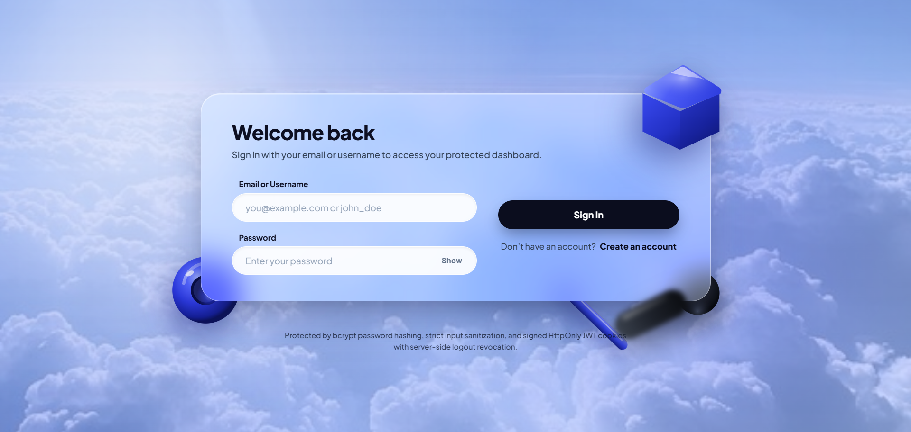
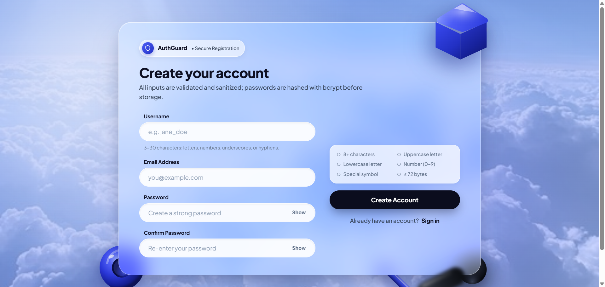
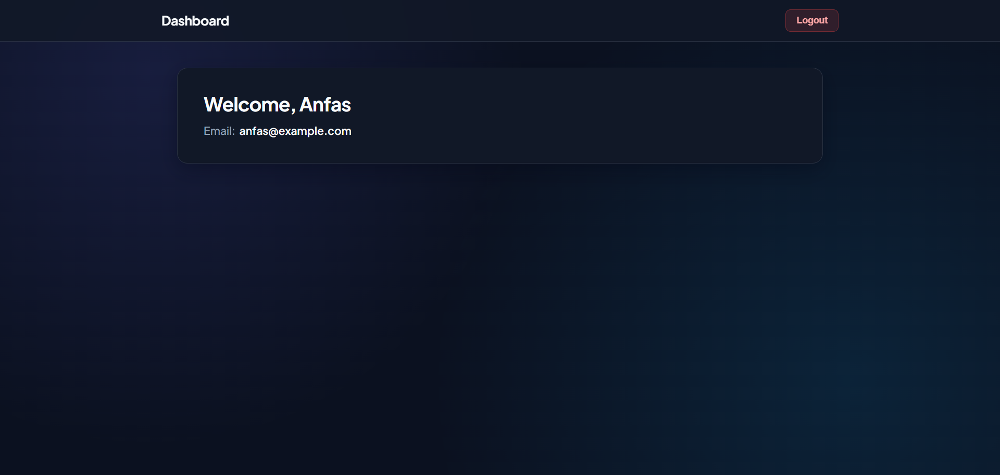
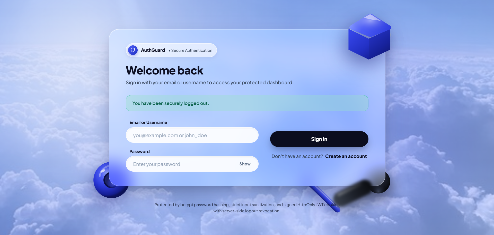
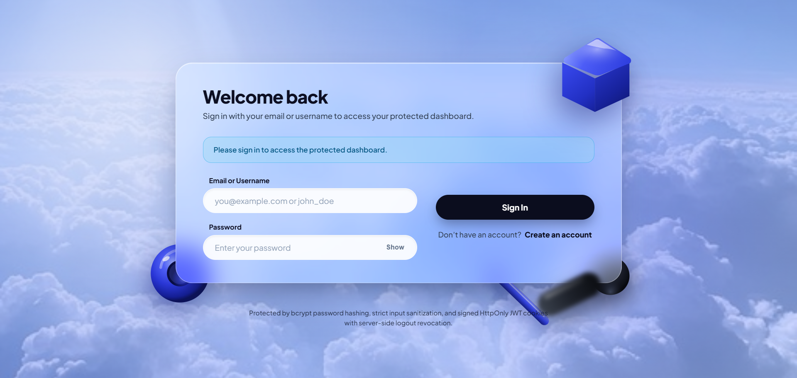
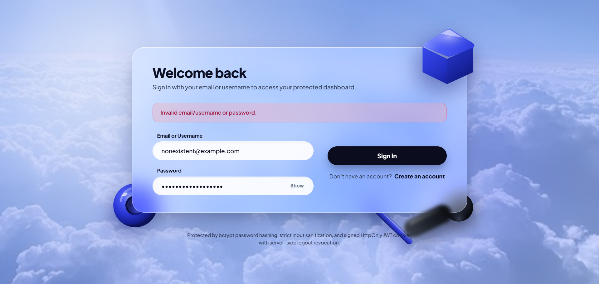

# Visual Demonstration Walkthrough

This document illustrates the complete end-to-end authentication workflow using high-resolution captures of the live application running on `http://localhost:5000`.

---

## Workflow Steps & Screenshots

### Step 1: Sign In Page Interface
The application opens to a modern frosted glassmorphism interface featuring 3D claymorphism decorative shapes and a photorealistic cloud background.

---

### Step 2: Create Account / Registration Page
The registration page provides real-time client-side and server-side validation, including an interactive password requirement checklist (8+ characters, uppercase, lowercase, numbers, special characters, and maximum 72 bytes).

---

### Step 3: Authenticated Protected Dashboard
After logging in, the user is redirected to the protected dashboard (`/dashboard`), which dynamically renders only the authenticated user's registered name and email address.

---

### Step 4: Successful Logout State
Clicking the "Logout" button invokes `POST /api/auth/logout`, clearing the `HttpOnly` session cookie and invalidating the token server-side.

---

### Step 5: Unauthenticated Route Guard Protection
Attempting to directly navigate to `/dashboard` without an active session triggers the server-side `protectPage` middleware, redirecting the user to `/login?reason=auth_required`.

---

### Step 6: Invalid Credentials Error Handling
Attempting to sign in with an invalid username, email, or password displays a normalized error message (`"Invalid email/username or password."`), preventing username enumeration attacks.

---

## Screen Recording Instructions

To generate a screen recording (`.mp4` / `.webm`) from this walkthrough:
1. Launch OBS Studio, Xbox Game Bar (`Win + G`), or Chrome Screen Recorder.
2. Follow the timed cue script in [`DEMO_SCRIPT.md`](DEMO_SCRIPT.md).
3. Save the resulting recording in `docs/demo/authentication_system_demo.mp4`.
